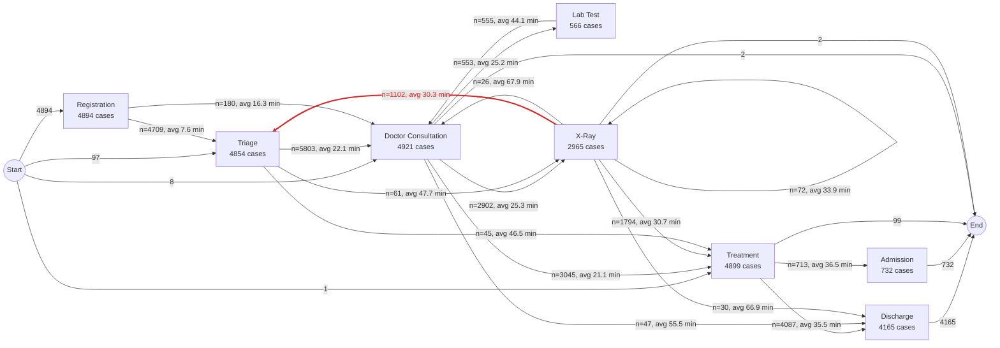

# As-Is Process Map (discovered from the event log)

Cases: **5000**. Each arrow shows how many times one step directly followed another and the average waiting time between them. **Red arrows are rework**: a patient sent back to an earlier intake step.

## Rework (loop-back) edges

| From | To | Times | % of all cases | % of cases reaching the From step | Avg minutes |
|---|---|---|---|---|---|
| X-Ray | Triage | 1102 | 22.0% | 37.2% | 30.3 |
| Doctor Consultation | Triage | 15 | 0.3% | 0.3% | 52.6 |

## Slowest hand-overs (average minutes)

| From | To | Avg minutes | Times |
|---|---|---|---|
| X-Ray | Admission | 69.5 | 11 |
| X-Ray | Doctor Consultation | 67.9 | 26 |
| X-Ray | Discharge | 66.9 | 30 |
| Lab Test | Treatment | 62.1 | 11 |
| Doctor Consultation | Doctor Consultation | 61.1 | 14 |
