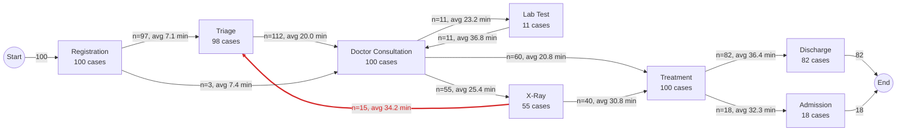

# As-Is Process Map (discovered from the event log)

Cases: **100**. Each arrow shows how many times one step directly followed another and the average waiting time between them. **Red arrows are rework**: a patient sent back to an earlier intake step.

## Rework (loop-back) edges

| From | To | Times | % of all cases | % of cases reaching the From step | Avg minutes |
|---|---|---|---|---|---|
| X-Ray | Triage | 15 | 15.0% | 27.3% | 34.2 |

## Slowest hand-overs (average minutes)

| From | To | Avg minutes | Times |
|---|---|---|---|
| Lab Test | Doctor Consultation | 36.8 | 11 |
| Treatment | Discharge | 36.4 | 82 |
| X-Ray | Triage | 34.2 | 15 |
| Treatment | Admission | 32.3 | 18 |
| X-Ray | Treatment | 30.8 | 40 |
